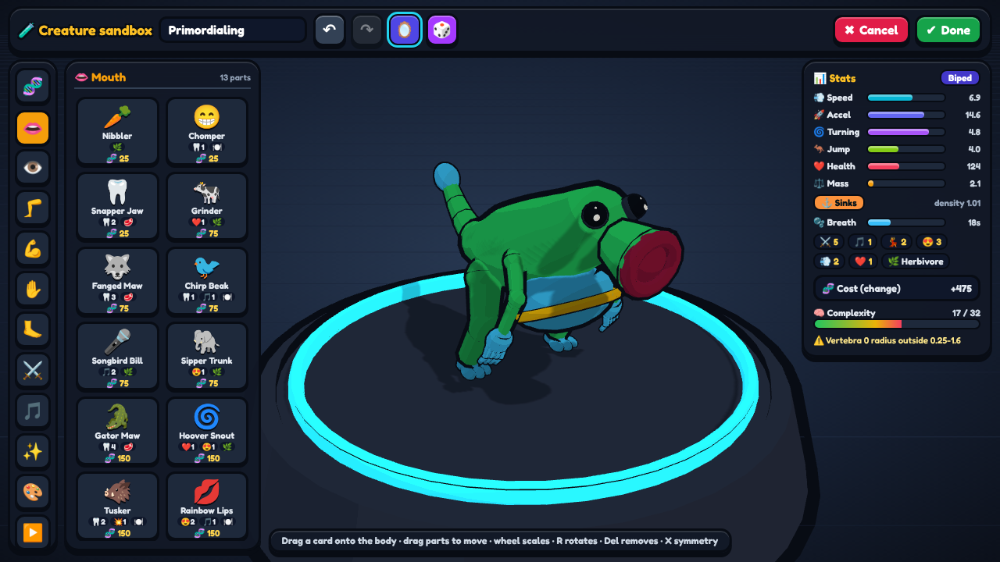
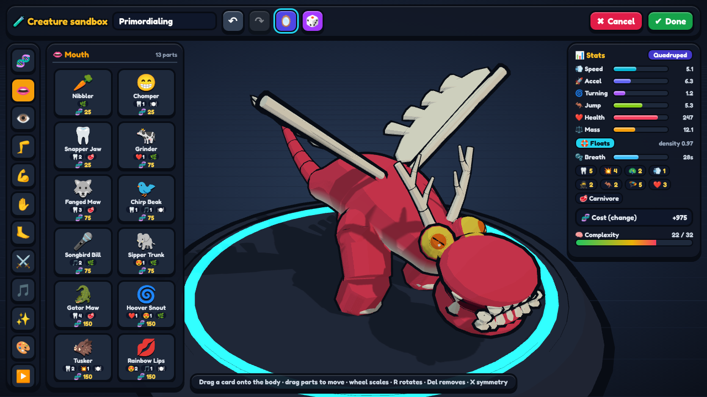
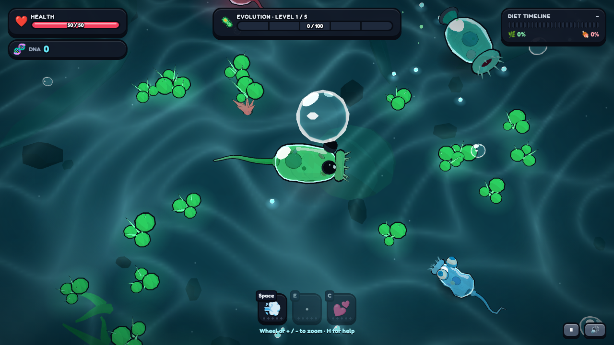
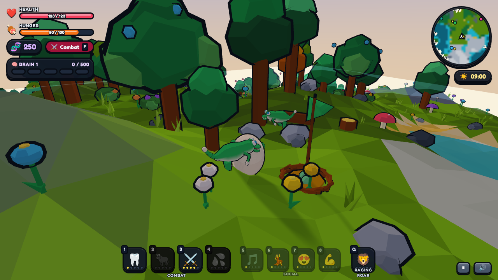
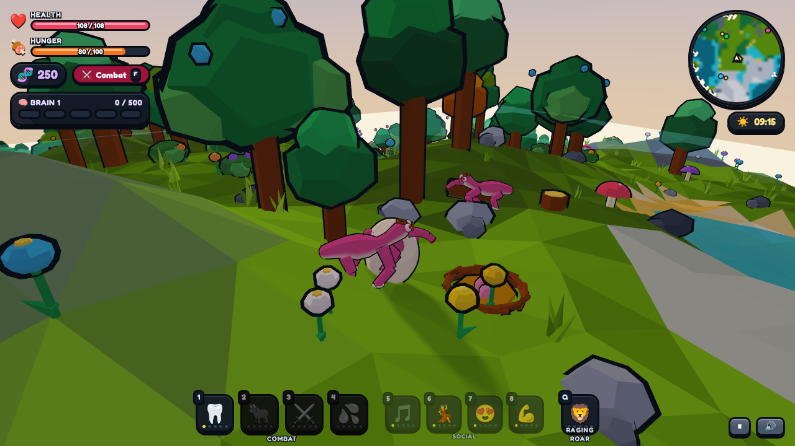
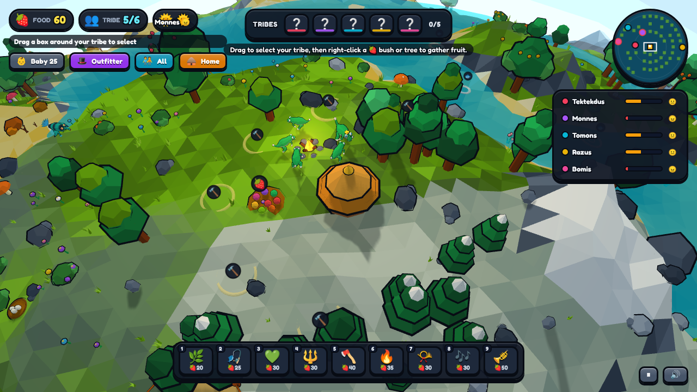
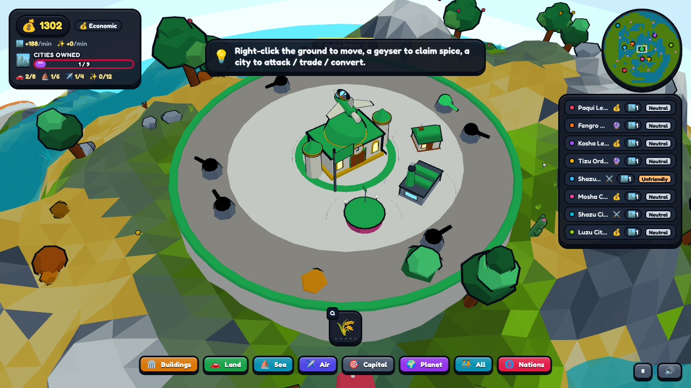
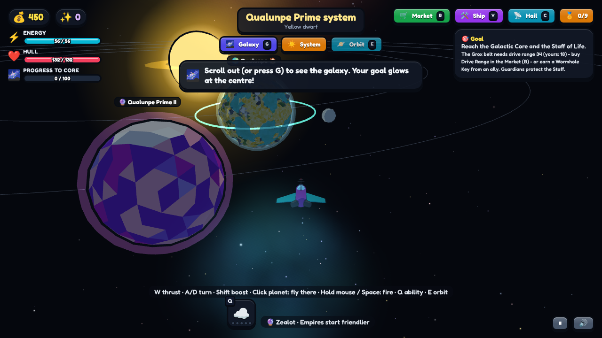

# Primordia

**Primordia** is a browser game about evolving a species from a single cell to the stars. It is a playable
re-creation of the classic five-stage "life to galaxy" arc, in a cel-shaded toy style. It is written in plain
JavaScript with Three.js r128 (vendored in `lib/`). There is no build step and no dependencies to install.

| | |
|---|---|
|  |  |
| **Creature editor.** Drag parts onto a body; stats update live. | **Another creature.** Mouths, eyes, limbs, spikes, wings and paint. |
|  |  |
| **Cell stage.** Eat, grow and evolve in a pond. | **Creature stage.** Explore a planet, find a nest and socialise or fight. |
|  |  |
| **A different species.** Every creature you build is animated and playable. | **Tribal stage.** Command a small tribe, gather food, meet rival tribes. |
|  |  |
| **Civilization stage.** Buy, trade with or conquer cities. | **Space stage.** Fly between star systems toward the galactic core. |

## The five stages
1. **Cell** - top-down pond survival, pick parts as you evolve.
2. **Creature** - build a creature in the editor, then explore a 3D planet.
3. **Tribal** - real-time tribe management with food, tools and diplomacy.
4. **Civilization** - cities, vehicles and a choice of religious, military or economic play.
5. **Space** - a ship, a galaxy of procedural systems and a goal at the core.

## Goals
- **Your creation is the hero.** Whatever you build in an editor appears, animates and behaves according to its parts. Parts change stats, stats change physics, physics change play.
- **One species, one story.** The same species, home planet and rivals carry through all five stages: nests become villages, villages become cities, cities become a homeworld seen from orbit.
- **A living world.** Food grows, populations rise and fall, predators hunt prey and species can go extinct. The player is one actor in an ecosystem.
- **Consequences.** How you play a stage (diet, social or aggressive) earns a card and a carried-forward ability that shapes the next stage.
- **Readable in 10 seconds.** Every stage has a clear goal bar and a toy-like UI.
- **Zero-friction to run.** No build step, no server, no network needed: open `index.html` and play.

### Roadmap
- Play the full campaign through in one session and tune pacing (Cell is short, Civ AI is aggressive).
- Finish the Creature-stage scale retune (animals vs trees) and fix remaining Civ economy edge cases.
- Measure and optimise performance on real GPUs (so far only software rendering was measured).
- Touch controls for the editors and RTS stages.
- Stretch: an Aquatic stage between Cell and Creature, epic cell boss, creature events (meteors, migration), pirates and wormholes in Space.

See [`docs/TODO.md`](docs/TODO.md), [`docs/DESIGN.md`](docs/DESIGN.md) (scope table) and [`docs/qa/KNOWN_ISSUES.md`](docs/qa/KNOWN_ISSUES.md) for details.

## Technical overview
| Area | Choice |
|---|---|
| Language | Plain JavaScript (ES2017+), classic IIFE scripts attached to one global namespace `window.SP`. No modules, no bundler. |
| Rendering | Three.js r128 (WebGL), vendored in `lib/`. Cel-shaded 3-tone toon materials with inverted-hull ink outlines. |
| Creatures | Procedural meshes built from a data design (parts, spine, limbs, paint) with a generated rig, gait animation, stat model and LOD. |
| World | Procedural low-poly planets with a surface sampler, sky and day cycle, a custom physics module and an ecology simulation (food, herds, predators, nests) with distance-based simulation LOD. |
| Editors | One editor framework for creature, cell, outfit, building, vehicle and ship designs. |
| Audio | Procedural Web Audio, no asset files. |
| UI | HTML/CSS overlay (Fredoka font, comic style); Fredoka loads from Google Fonts but falls back offline. |
| Saves | `localStorage`, every access wrapped in try/catch. |
| Performance targets | 60 fps on a mid laptop, 30 fps minimum, under 600 draw calls (instancing for props). |
| Testing | Node unit and simulation tests in `tests/`, browser harnesses (`tests/*.html`), and an autoplay bot that plays the whole campaign through the real input (`docs/TESTRIG.md`). |

Size: about 23,000 lines of JavaScript in `js/`. See [`docs/ARCHITECTURE.md`](docs/ARCHITECTURE.md) for module contracts and load order.

## Play
- Easiest: double-click `index.html` (it runs from `file://`), or
- run `python3 -m http.server 8080` in this folder and open http://localhost:8080

On the title screen, **New Game** plays the whole campaign and **Stage Select** jumps to any stage or editor.
Press **H** in any stage for controls and **Esc** to pause.

Dev URL parameters: `?stage=cell|creature|tribal|civ|space`, `?editor=creature|cell|outfit|building|vehicle|ship`,
`?skipintro=1`, `?seed=123`, `?fast=1`. Add `?autoplay=1` to watch a bot play (see `docs/TESTRIG.md`).

## Tests
Plain Node scripts, no install needed:

```
for t in tests/*_test.js; do node "$t"; done
```

`tests/*.html` are browser harnesses for the editor, creature models, world and UI.

## Documentation
All docs are in [`docs/`](docs/README.md): design, art guide, architecture, test rig, QA reports and the TODO list.

## Project layout
`js/core` engine, `js/creature` creature models and animation, `js/editors` editors, `js/world` planet, ecology and physics,
`js/stages` the five stages, `js/testrig` the autoplay bot, `css` styles, `tools` dev scripts, `tests`, `docs`.
